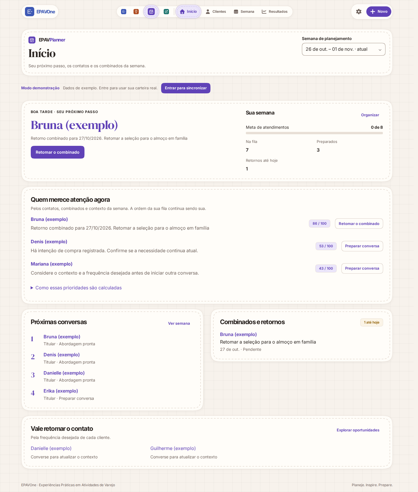
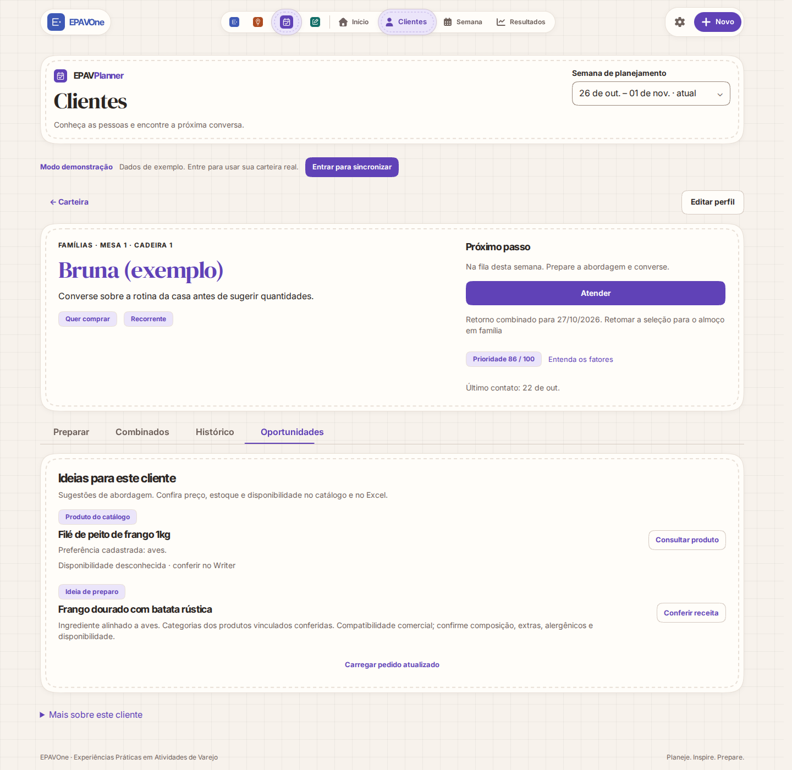

# Revisão da inteligência comercial V1 — 28/10/2026

Implementação e limitações: [documentação do motor](../commercial-intelligence.md).

## Resultado

- `npm run verify` aprovado: **105 arquivos / 551 testes**, arquitetura, tokens e build. Lint sem erros; permanece um aviso de console preexistente em `tests/add-only-import-sql.test.js`.
- 29 testes novos: domínio e dados incompletos, pesos/empates, restrições, disponibilidade/ingredientes, execução em fatias/cancelamento, cache público compartilhado/invalidação, leitura em lotes, atualização de contexto, troca de conta, links reais e complementos do pedido exportado associado.
- Chromium/Playwright: **25 telas** em 320, 390, 601 e 1440 px; claro/escuro; Alto desempenho, Equilibrado e Fabuloso; movimento reduzido. Sem overflow horizontal, clipping das sugestões ou erros JavaScript.
- Mesma pontuação e explicação nas cinco combinações de viewport/tema/modo, para Início e Semana. A fila manual permaneceu na ordem definida pelo usuário.
- Teclado: foco e Enter no link da receita, abertura do diálogo existente no Insights, Escape para fechar. As interações novas usam componentes e âncoras nativas do DS. Não equivale a auditoria completa com leitor de tela.
- Fixtures sintéticos e modo demonstração explícito. As chamadas públicas foram interceptadas e qualquer método diferente de GET rejeitado. Nenhuma gravação em produção.

## Desempenho

| Cenário sintético | Resultado |
| --- | --- |
| Node, 200 clientes, 1.002 produtos, 100 receitas, 4.000 interações; 25 execuções | Mediana 3,98 ms; P95 9,30 ms |
| Chromium, 200 perfis distintos, mesmos volumes; CPU 6×, teto V8 de 512 MB; 15 execuções | Mediana síncrona 57,2 ms; P95 145,8 ms, incluindo aquecimento |
| Caminho usado na UI, matching em fatias canceláveis | Mediana de processamento 61,4 ms; tempo total com cessões ao navegador 95,9 ms; maior trecho individual observado 18,5 ms |

A primeira versão síncrona da mesma simulação de 200 perfis distintos apresentou mediana de 472,1 ms. O índice passou a preparar DTOs públicos uma vez, os formatadores foram reutilizados, as datas foram validadas por valor distinto e o matching passou a ceder execução em fatias. O tempo total não representa latência de rede nem carregamento completo da página.

Dados brutos: [Node](performance.json), [Chromium e fatias](browser-performance.json), [matriz visual e requisições](browser-results.json). Scripts de reprodução estão em `scripts/benchmark-commercial-intelligence.mjs`, `scripts/benchmark-commercial-browser.mjs` e `scripts/review-commercial-intelligence.mjs`.

Não houve validação física no Galaxy Tab A7 Lite, medição da RAM do Android, teste de sessão autenticada real ou homologação de estoque Swift. CPU 6× e limite de heap são apenas simulação. O modo de apresentação não altera o motor.

## Capturas

As capturas representam a aplicação real em Chromium, com dados fictícios. Tipografia e componentes reais do repositório, sem mockup de interface.

### Início no desktop, tema claro

### Perfil e oportunidades no desktop

### Início no celular, tema escuro

### Oportunidades no celular, tema escuro

### Semana no tablet, Alto desempenho e movimento reduzido

